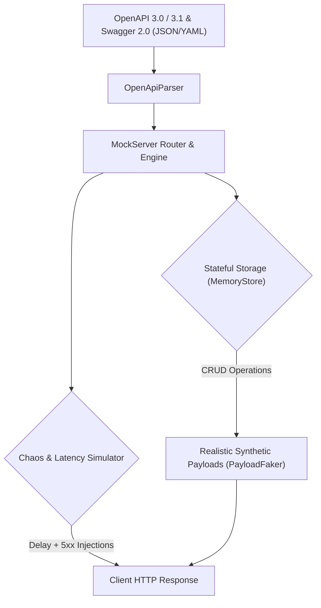

[🇸🇦 العربية](README.ar.md) | [🇬🇧 English](README.md)

# 🎭 eidcloud-api-mock

Schema-driven universal API mock server with OpenAPI ingestion, stateful storage, and chaos latency simulation in pure PHP 8.2+.

[](https://github.com/eidcloud/eidcloud-api-mock/releases)
[](https://www.php.net)
[](LICENSE)
[](https://colab.research.google.com/github/eidcloud/eidcloud-api-mock/blob/main/notebooks/quickstart.ipynb)

---

## 🌟 Overview

**eidcloud-api-mock** is a zero-dependency, ultra-fast mock server and API sandbox built for modern microservices and front-end prototyping. It parses OpenAPI 3.0 / 3.1 & Swagger 2.0 specifications on the fly, produces realistic synthetic payloads (matching UUIDs, emails, RFC3339 timestamps, URIs, and regex constraints), persists dynamic state across calls, and injects controlled network latency and chaos errors for resilience testing.



---

## ✨ Capabilities

- **Zero External Dependencies**: Operates exclusively on pure standard PHP 8.2+, requiring no composer packages or C extensions.
- **Specification Ingestion**: Ingests both JSON and YAML OpenAPI 3.0, 3.1, and Swagger 2.0 documents with full `$ref` resolution.
- **Realistic Synthetic Payloads**: Intelligent faker heuristics for UUIDs (`uuid`), email (`email`), dates (`date-time`), web URLs (`uri`), IP addresses (`ipv4`), enum constraints, and semantic names.
- **Dynamic Stateful Storage**: Memory-backed stateful store. Creating an entity with `POST /users` immediately reflects in subsequent calls to `GET /users/{id}` or `GET /users`.
- **Chaos Engineering & Resilience Simulation**: Injects realistic latency jitter (`--delay=150ms`) and intermittent HTTP error spikes (`--error-rate=15%` triggering 500, 502, 503, 504).
- **Built-in HTTP Micro-Server**: Direct integration with PHP's built-in web server through `bin/eidcloud-mock serve`.
- **Static Fixture Generator**: Generate complete static JSON mock trees with `bin/eidcloud-mock generate --out=./mock_data/`.

---

## 🚀 Quick Start & CLI Usage

### 1. Installation

Clone repository:
```bash
git clone https://github.com/eidcloud/eidcloud-api-mock.git
cd eidcloud-api-mock
```

Or install via Composer:
```bash
composer require eidcloud/api-mock
```

### 2. Start Live Mock Server

Serve an OpenAPI specification with 150ms delay and 10% chaos failure rate:
```bash
php bin/eidcloud-mock serve examples/openapi.json --port=8080 --delay=150ms --error-rate=10%
```

Test an endpoint using `curl`:
```bash
# 1. Create a user (Stateful)
curl -X POST http://localhost:8080/users \
  -H "Content-Type: application/json" \
  -d '{"name": "Eng. Shadi AL-Hasan", "email": "shadi@eidcloud.io", "role": "admin"}'

# 2. Retrieve user
curl http://localhost:8080/users/1
```

### 3. Generate Static Mock Fixtures

Export synthetic JSON fixtures for frontend mock directories or CI staging:
```bash
php bin/eidcloud-mock generate examples/openapi.json --out=./mock_data/ --json
```

### 4. Validate Specification

Inspect registered endpoints and check schema compatibility:
```bash
php bin/eidcloud-mock validate examples/openapi.json
```

---

## 💻 Programmatic Usage (PHP Library)

```php
<?php

use EidCloud\ApiMock\MockServer;
use EidCloud\ApiMock\Simulator\ChaosSimulator;

require_once __DIR__ . '/vendor/autoload.php';

// Initialize with latency and chaos simulation
$chaos = new ChaosSimulator(delayMs: 120, errorRate: 0.05);
$server = new MockServer('openapi.json', null, $chaos);

// Handle HTTP requests programmatically
$response = $server->handle('GET', '/users/1');

echo "HTTP Status: " . $response['statusCode'] . "\n";
print_r($response['body']);
```

---

## 🧪 Testing

Run the zero-dependency test suite:
```bash
php tests/run_tests.php
```

---

## 👤 Author & Maintainer

**Eng. MHD. Shadi AL-Hasan**  
- **Role:** Executive CTO & Enterprise Solutions Architect  
- **Email:** [mhd.shadi.alhasan@gmail.com](mailto:mhd.shadi.alhasan@gmail.com)  
- **Phone / WhatsApp:** [+963934005922](tel:+963934005922)  
- **Location:** Damascus, Syria  
- **GitHub:** [shadialhasan](https://github.com/shadialhasan)  

---

## 📄 License

This project is licensed under the MIT License - see the [LICENSE](LICENSE) file for details.  
Copyright (c) 2026 **MHD. Shadi AL-Hasan**. All rights reserved.
